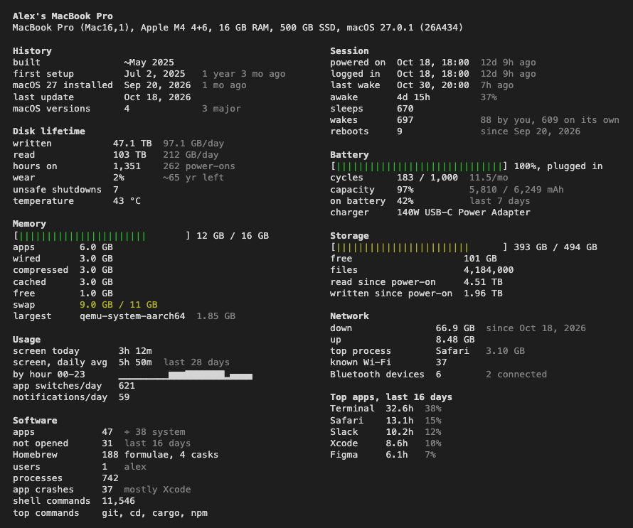

# probeg

Lifetime statistics for your Mac: when it was built, how much it has written to disk, battery cycles, uptime, most used apps. Think neofetch, but for how the machine has been used instead of what's in it.

*Probeg* (пробег) is Russian for a car's mileage.

```
$ probeg
```



macOS only. No root, no daemon, nothing stored, no network access.

[Русский](README.ru.md)

## Install

```sh
curl -fsSL https://raw.githubusercontent.com/guitvcer/probeg/main/install.sh | sh
```

Or with Rust: `cargo install --git https://github.com/guitvcer/probeg`. Binaries for Apple Silicon and Intel are also on the [releases page](https://github.com/guitvcer/probeg/releases); a file downloaded in a browser is blocked by macOS until you run `xattr -d com.apple.quarantine probeg`.

## Options

```
--lang <CODE>   en, ru, zh, es, pt, fr, de, ja, ko (default: system language)
--json          all readings as JSON
--plain         no color
--demo          made-up data
```

`PROBEG_LANG` sets the language permanently. `NO_COLOR` is respected. Colors come from your terminal theme.

## Where the numbers come from

| Reading | Source | Covers |
|---|---|---|
| Disk written/read, hours on, wear, unsafe shutdowns | NVMe health log | whole life |
| Build date | first install history entry (an estimate) | whole life |
| First setup, macOS versions | install history, setup marker | whole life |
| Battery cycles, capacity | battery controller | whole life |
| Network traffic | interface counters | since power-on |
| Screen time, apps, notifications | macOS activity database | a few weeks |
| Time on battery | power log | about a week |
| Crashes | diagnostic reports | about a month |

macOS doesn't keep lifetime network totals, so there are none here.

Screen time and app usage need Full Disk Access for your terminal (System Settings > Privacy & Security). Without it those sections show a hint and the rest works.

Serial numbers are never read. Only program names are taken from shell history, not their arguments. The output does include your computer name and username.

## Status

Tested on one machine: MacBook Pro M4, macOS 27. Other Macs should work, and anything a machine can't report is left out, but expect rough edges. Issues welcome, ideally with `probeg --json` output.

Translations were not written by native speakers. To fix one, edit its file in `src/i18n/`. To add a language, copy `en.rs` and register it in `mod.rs`; tests catch missing placeholders and lines that don't fit.

## Development

`scripts/check.sh` runs formatting, lints and tests. `git config core.hooksPath .githooks` runs it before each commit.

## License

MIT
