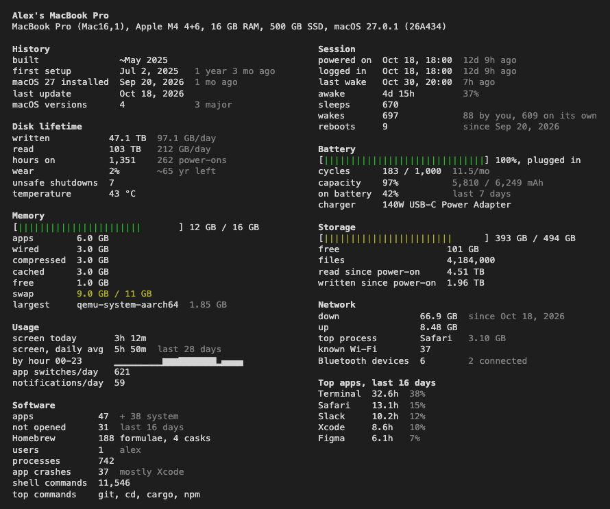

# probeg

Статистика Mac за всю его жизнь: когда собран, сколько записал на диск, циклы батареи, время работы, частые приложения. Как neofetch, только про то, как машиной пользовались, а не что у неё внутри.

```
$ probeg
```



Только macOS. Без root и фоновых процессов, ничего не хранит и не ходит в сеть.

## Установка

```sh
curl -fsSL https://raw.githubusercontent.com/guitvcer/probeg/main/install.sh | sh
```

Или через Rust: `cargo install --git https://github.com/guitvcer/probeg`. Файлы для Apple Silicon и Intel есть и на [странице релизов](https://github.com/guitvcer/probeg/releases); скачанный через браузер файл macOS заблокирует, пока не выполнить `xattr -d com.apple.quarantine probeg`.

## Параметры

```
--lang <CODE>   en, ru, zh, es, pt, fr, de, ja, ko (по умолчанию язык системы)
--json          все показания в JSON
--plain         без цвета
--demo          вымышленные данные
```

`PROBEG_LANG` задаёт язык насовсем. Учитывается `NO_COLOR`. Цвета берутся из темы терминала.

Для экранного времени и приложений терминалу нужен Полный доступ к диску (Системные настройки > Конфиденциальность и безопасность). Без него эти разделы покажут подсказку, остальное работает.

Серийные номера не читаются. Из истории команд берутся только названия программ, без аргументов. Имя компьютера и пользователя в выводе есть.

## Лицензия

MIT
